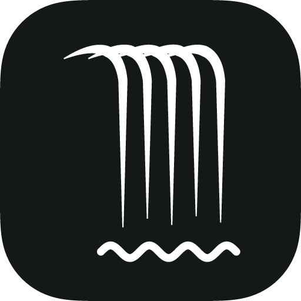

# Meander

**Meander** is an AI learning app by Vincent Chu: adaptive teaching, practice, spaced review that tracks what you're forgetting, your own tools in practice sessions, Find Everything (search sessions, ideas and your files), multi-device sync, Anki export, learning whole folders, and study stats. It updates itself.

**Download:** [latest release](https://github.com/vinceychu/meander/releases/latest) · **Guide:** [GUIDE.md](GUIDE.md)

Copyright © 2026 Vincent Chu. Licensed under the AGPL-3.0 (see [LICENSE](LICENSE) and [NOTICE](NOTICE)).
